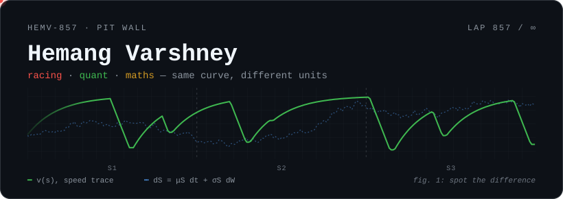

<p align="center">
  
</p>

<p align="center">
  I build the things that sit between a stopwatch and a stochastic process:<br>
  F1 strategy models, matching engines, volatility surfaces, and the maths that holds them up.
</p>

<p align="center">
  <a href="#-the-maths-twice">The maths, twice</a> ·
  <a href="#%EF%B8%8F-on-track">On track</a> ·
  <a href="#-in-the-market">In the market</a> ·
  <a href="#-under-the-bonnet">Under the bonnet</a> ·
  <a href="#-team-radio">Team radio</a>
</p>

<p align="center"></p>

## 🏁 The maths, twice

A race and a market pose the same problem: make a decision under uncertainty, against the clock, with someone faster than you trying to make it first. Most of my repos are one of these five ideas, worked out on one side of the pit wall or the other.

| The idea | 🏎️ On track | 📈 In the market |
|---|---|---|
| **Fit a curve, act on the residual** | [predictive-tire-engine](https://github.com/hemv-857/predictive-tire-engine): where the tyre is on its degradation curve | [svi-scanner](https://github.com/hemv-857/svi-scanner): where Deribit quotes sit off a fitted SVI surface |
| **Spend a scarce resource at the right moment** | [apex-racing-live-strategy](https://github.com/hemv-857/apex-racing-live-strategy): the pit window, traded against tyre and fuel | [lob-engine](https://github.com/hemv-857/lob-engine): TWAP / VWAP / POV execution schedules |
| **Separate signal from noise** | [f1-performance-intelligence](https://github.com/hemv-857/f1-performance-intelligence): telemetry, read by an AI race engineer | [rmt-covariance](https://github.com/hemv-857/rmt-covariance): Random Matrix Theory strips noise out of correlations |
| **Events cluster** | One safety car and half the field pits on the same lap | [hawkes-lob](https://github.com/hemv-857/hawkes-lob): do BTC trades self-excite like order books do? |
| **Milliseconds are the margin** | A 2-second stop wins the undercut; a 4-second one hands it back | [limit-order-book](https://github.com/hemv-857/limit-order-book): no locks on the hot path · [market-pipeline](https://github.com/hemv-857/market-pipeline): 35 ms end to end |

## 🏎️ On track

An F1 trilogy, built in race order: predict the tyre, read the car, make the call.

| Stint | Repo | What it does |
|:-:|---|---|
| **1 · Predict** | [predictive-tire-engine](https://github.com/hemv-857/predictive-tire-engine) | Tyre degradation predictor with a D3 dashboard on live telemetry |
| **2 · Read** | [f1-performance-intelligence](https://github.com/hemv-857/f1-performance-intelligence) | Telemetry dashboard with an AI race engineer on the radio |
| **3 · Decide** | [apex-racing-live-strategy](https://github.com/hemv-857/apex-racing-live-strategy) | Race strategy simulator: tyre and fuel modelling, pit-stop optimisation |

## 📈 In the market

**Microstructure: where prices actually get made**

| Repo | What it does |
|---|---|
| [limit-order-book](https://github.com/hemv-857/limit-order-book) | Deterministic limit order book and matching engine in C++20. Determinism is tested, not hoped for |
| [lob-engine](https://github.com/hemv-857/lob-engine) | Price-time priority LOB in std-only Rust, plus TWAP / VWAP / POV execution algorithms |
| [hawkes-lob](https://github.com/hemv-857/hawkes-lob) | Hawkes process model testing whether BTC trades self-excite |
| [market-pipeline](https://github.com/hemv-857/market-pipeline) | Binance WebSocket → Redis → FastAPI, 35 ms end to end |

**Volatility and risk: where prices get questioned**

| Repo | What it does |
|---|---|
| [svi-scanner](https://github.com/hemv-857/svi-scanner) | Fits an SVI volatility surface to Deribit options, then hunts for where the market disagrees with it |
| [rbergomi-engine](https://github.com/hemv-857/rbergomi-engine) | Rough-volatility pricing: Monte Carlo with control variates, calibrated to live SPX options |
| [rmt-covariance](https://github.com/hemv-857/rmt-covariance) | Covariance cleaning with Random Matrix Theory vs Ledoit-Wolf, with walk-forward backtests |
| [cognitive-convergence-detector](https://github.com/hemv-857/cognitive-convergence-detector) | Flags when institutional signals converge: crowded positioning as an early warning for systemic risk |
| [151-trading-strats](https://github.com/hemv-857/151-trading-strats) | 151 strategies across 18 asset classes, after Kakushadze &amp; Serur (2018) |

## 🧮 Under the bonnet

The equations these repos are built on. If you read these before the tables, we'll get along.

**SVI smile** · [svi-scanner](https://github.com/hemv-857/svi-scanner). Total implied variance at log-moneyness $k$, in Gatheral's raw parameterisation:

```math
w(k) = a + b\left(\rho\,(k-m) + \sqrt{(k-m)^2 + \sigma^2}\right)
```

**Rough Bergomi** · [rbergomi-engine](https://github.com/hemv-857/rbergomi-engine). Variance driven by a Volterra process whose Hurst exponent $H$ sits near $0.1$, far rougher than Brownian motion:

```math
V_t = \xi_0(t)\,\exp\left(\eta\sqrt{2H}\int_0^t (t-s)^{H-\frac{1}{2}}\,dW_s - \frac{\eta^2}{2}\,t^{2H}\right)
```

**Hawkes intensity** · [hawkes-lob](https://github.com/hemv-857/hawkes-lob). Every trade raises the odds of the next one, and the effect decays. The process stays stable while the branching ratio $\alpha/\beta < 1$:

```math
\lambda(t) = \mu + \sum_{t_i < t} \alpha\, e^{-\beta\,(t - t_i)}
```

**Marchenko–Pastur** · [rmt-covariance](https://github.com/hemv-857/rmt-covariance). With $N$ assets and $T$ observations, $q = N/T$, the eigenvalues of a pure-noise correlation matrix stay inside these bounds. Anything above $\lambda_+$ is worth a look:

```math
\lambda_\pm = \left(1 \pm \sqrt{q}\right)^2
```

**The pit-stop inequality** · [apex-racing-live-strategy](https://github.com/hemv-857/apex-racing-live-strategy). The back-of-envelope version: box on lap $n$ when what the old tyres will lose over the rest of an $N$-lap race is more than the stop costs. It is optimal stopping in a fireproof suit:

```math
\sum_{j=n}^{N} \left(\delta_{\text{old}}(j) - \delta_{\text{new}}(j)\right) > t_{\text{pit}}
```

More probability than finance: [Projects](https://github.com/hemv-857/Projects) holds experiments in probability calibration, decision theory and betting.

## 🔧 Pit crew for other people's cars

Greenfield repos are the easy part. Getting a change merged into someone else's codebase is the part I'm proudest of: **14 merged so far**, mostly in quant libraries and developer tooling.

**Quant and research**

- **[ArturSepp/QuantInvestStrats#192](https://github.com/ArturSepp/QuantInvestStrats/pull/192)**: reconstruct instrument P&L across missing quotes, so contributions still sum to NAV
- **[ArturSepp/QuantInvestStrats#225](https://github.com/ArturSepp/QuantInvestStrats/pull/225)**: run the offline quickstart with sockets patched to raise, so a network call can never pass silently
- **[ArturSepp/QuantInvestStrats#227](https://github.com/ArturSepp/QuantInvestStrats/pull/227)**: map every printed quickstart output to the Python object that produced it
- **[google-research/timesfm#552](https://github.com/google-research/timesfm/pull/552)**: raise an actionable, chained error when an optional backend is missing, without breaking `hasattr` probes
- **[google-research/timesfm#555](https://github.com/google-research/timesfm/pull/555)**: apply the same contract to the `timesfm3` top-level re-exports
- **[bloomberg/causal-ts#83](https://github.com/bloomberg/causal-ts/pull/83)**: guard batched ParCorrGPU precision inverses, falling back to OLS instead of inverting an ill-conditioned matrix
- **[bloomberg/causal-ts#85](https://github.com/bloomberg/causal-ts/pull/85)**: pair all 30 example notebooks with Jupytext scripts, so changes review as `.py` diffs
- **[bloomberg/causal-ts#86](https://github.com/bloomberg/causal-ts/pull/86)**: set up all-contributors, seeded with every human contributor

**Compilers, runtimes and tooling**

- **[swiftlang/swift#93473](https://github.com/swiftlang/swift/pull/93473)**: retry each clone/update in `update-checkout`, instead of re-fetching all 51 repositories when one flakes
- **[google/adk-go#1903](https://github.com/google/adk-go/pull/1903)**: send live tool responses through the sender goroutine, so the single-writer invariant holds
- **[affaan-m/ECC#3590](https://github.com/affaan-m/ECC/pull/3590)**: accept JSONC comments in `opencode.json` while checking config membership during `ecc install`
- **[morluto/rea#4219](https://github.com/morluto/rea/pull/4219)**: honour package-main selection for trailing-slash directory references
- **[morluto/rea#4511](https://github.com/morluto/rea/pull/4511)**: keep CommonJS ``require(`mod`)`` dependencies visible in the source graph
- **[tt-a1i/archify#986](https://github.com/tt-a1i/archify/pull/986)**: add class, tree, timeline and waterfall promoted-type recipes

<details>
<summary><b>17 open PRs in the pit lane, awaiting review</b></summary>

| Project | PR |
|---|---|
| [swiftlang/swift#93581](https://github.com/swiftlang/swift/pull/93581) | clearer errors for inherited-only type attributes |
| [sympy/sympy#30901](https://github.com/sympy/sympy/pull/30901) | factor `CC` polynomials over the Gaussian rationals so `is_irreducible` and `factor` agree |
| [openai/tiktoken#623](https://github.com/openai/tiktoken/pull/623) | restore manylinux2014 x86_64 wheels |
| [microsoft/qlib#2386](https://github.com/microsoft/qlib/pull/2386) | drop `pkg_resources` from `collect_info.py` |
| [goldmansachs/gs-quant#409](https://github.com/goldmansachs/gs-quant/pull/409) | size the default correlation window on cleaned returns |
| [google/adk-go#2273](https://github.com/google/adk-go/pull/2273) | serialize concurrent appends to one session row |
| [google/adk-go#2274](https://github.com/google/adk-go/pull/2274) | run the tool callbacks for a failed streaming tool |
| [crewAIInc/crewAI#8490](https://github.com/crewAIInc/crewAI/pull/8490) | filter pull requests before limiting GitHub issues |
| [dagster-io/dagster#34361](https://github.com/dagster-io/dagster/pull/34361) | exclude dbt v2 unit tests from fusion result events |
| [ray-project/ray#67476](https://github.com/ray-project/ray/pull/67476) | bump the starlette floor past known CVEs |
| [openyurtio/openyurt#2843](https://github.com/openyurtio/openyurt/pull/2843) | fall back to an interface address when there is no default route |
| [bloomberg/bde#320](https://github.com/bloomberg/bde/pull/320) | fix MSVC `/bigobj` flags for bsl and bdlar |
| [jaegertracing/jaeger#9839](https://github.com/jaegertracing/jaeger/pull/9839) | align built-in skill descriptions with the index |
| [jaegertracing/jaeger#9842](https://github.com/jaegertracing/jaeger/pull/9842) | restore the MCP tool limit tunables |
| [morluto/rea#3525](https://github.com/morluto/rea/pull/3525) | recover structured tool arguments sent as JSON text |
| [jankrepl/deepdow#152](https://github.com/jankrepl/deepdow/pull/152) | `__sub__` / `__rsub__` on the `Loss` class |
| [topoteretes/cognee-community#202](https://github.com/topoteretes/cognee-community/pull/202) | Raindrop.io data-source connector |

</details>

<p align="center"></p>

## 🧰 In the garage

Off the racing line, but still running.

<details>
<summary><b>18 more repos: AI tooling, fintech, and native apps</b></summary>

**AI tooling and agents**

| Repo | What it does |
|---|---|
| [mcp-vetter-agent](https://github.com/hemv-857/mcp-vetter-agent) | AI agent that audits MCP servers before you connect to them |
| [Codeinsight](https://github.com/hemv-857/Codeinsight) | Ask questions about any repo in plain English; see the architecture it infers |
| [edge-mem](https://github.com/hemv-857/edge-mem) | Offline-first edge knowledge engine with Qdrant-backed cloud federation |
| [intellex](https://github.com/hemv-857/intellex) | Natural-language requests → clean, source-backed datasets |
| [vizql](https://github.com/hemv-857/vizql) | Visual SQL explainer: watch a query execute step by step |
| [vizarch](https://github.com/hemv-857/vizarch) | System architecture diagrams from plain English, as SVG |
| [commit-archaeology](https://github.com/hemv-857/commit-archaeology) | Commit history → feature eras, who broke what, and the bus factor |
| [dependency-time-machine](https://github.com/hemv-857/dependency-time-machine) | Any repo + any past date → that project's snapshot, plus what shipped since |
| [impact-lens](https://github.com/hemv-857/impact-lens) | Impact and sustainability media analysis, before/after comparison |
| [J.A.R.V.I.S](https://github.com/hemv-857/J.A.R.V.I.S) | Finds issues matching your skills, plans the contribution, drafts the PR |

**Fintech**

| Repo | What it does |
|---|---|
| [ptm-recovery-agent](https://github.com/hemv-857/ptm-recovery-agent) | Recovers failed Paytm payments, measuring true incremental lift |
| [rzp-recovery-agent](https://github.com/hemv-857/rzp-recovery-agent) | Same for Razorpay: causal, not just "recovered count" |
| [FinCortex_Finvigators](https://github.com/hemv-857/FinCortex_Finvigators) | AI CFO assistant: spend, cashflow forecasting, planning |

**Platforms, native apps and utilities**

| Repo | What it does |
|---|---|
| [ORION](https://github.com/hemv-857/ORION) | Real-time geopolitical risk dashboard: energy supply chains and conflicts |
| [textdistance-rs](https://github.com/hemv-857/textdistance-rs) | Rust port of textdistance: 43 algorithms, 77–1788× faster than Python |
| [agent-office-app](https://github.com/hemv-857/agent-office-app) | macOS SwiftUI app running multiple AI agents with streaming, cost tracking and task queues |
| [PRESENT](https://github.com/hemv-857/PRESENT) | macOS menubar attendance tracker with safe-skip maths and lecture reminders |
| [internship-tracker](https://github.com/hemv-857/internship-tracker) | Scrapes 270+ companies and sends daily digests via Telegram |

</details>

## 🛠 Setup sheet

<p align="center">
  
  
  
  
  
  
  
  
  
  
</p>

<p align="center">
  
  
  
</p>

## 📻 Team radio

Open to full-time roles in quant research, trading systems, or anywhere a strategy call is really a maths problem. Motorsport included.

- GitHub: [@hemv-857](https://github.com/hemv-857) (you're here)
- Email / LinkedIn: in the profile sidebar

Skip the cover letter and give me a concrete problem: a matching-engine latency bug, a wing of the vol surface that won't fit, or a one-stop that should have been a two-stop. I'll have opinions before the call ends.

<p align="center"><sub>Box, box. · <a href="https://github.com/hemv-857/hemv-857/blob/main/LICENSE">MIT</a></sub></p>
